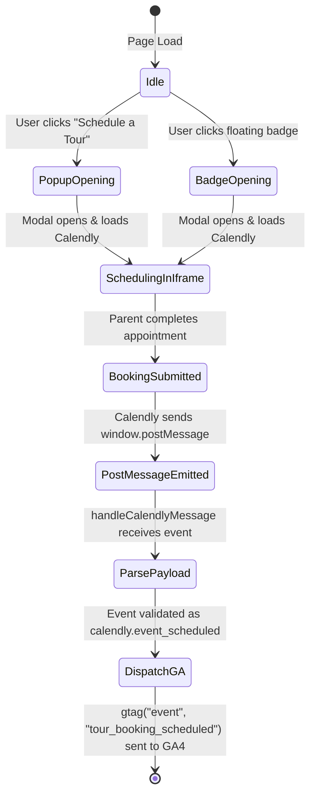

# Data Model & Schema Contracts: Tour Booking Analytics Tracking

**Feature Branch**: `008-fix-tour-analytics`  
**Date**: October 28, 2026  

## Data Entities & Payloads

### 1. Calendly PostMessage Event Payload (Inbound)

Represents the raw `MessageEvent` data received from the Calendly iframe or widget popup.

| Field | Type | Description | Requirements / Validation |
|---|---|---|---|
| `event` | `string` | The event identifier string | Must equal `'calendly.event_scheduled'` |
| `payload` | `object` (optional) | Metadata about the scheduled event | Contains event resource URIs (e.g. `event.uri`, `invitee.uri`) |

#### Raw Format Handling:
- **Object Format**: `{ event: 'calendly.event_scheduled', payload: { ... } }`
- **Stringified Format**: `"{\"event\":\"calendly.event_scheduled\",\"payload\":{...}}"`

```typescript
export interface CalendlyEventPayload {
  event: string;
  payload?: {
    event?: {
      uri?: string;
    };
    invitee?: {
      uri?: string;
    };
    [key: string]: unknown;
  };
}
```

---

### 2. Google Analytics Conversion Event (Outbound)

Represents the conversion event dispatched to `window.gtag` and `window.dataLayer`.

| Parameter | Type | Required | Value / Format | Description |
|---|---|---|---|---|
| `event` | `string` | Yes | `'tour_booking_scheduled'` | Standard GA4 event name |
| `event_category` | `string` | Yes | `'engagement'` | High-level category |
| `event_label` | `string` | Yes | `'Calendly Widget'` | Identifies widget source |
| `value` | `number` | Yes | `1` | Quantitative conversion count |

```typescript
export interface GAConversionEventPayload {
  event: 'tour_booking_scheduled';
  event_category: 'engagement';
  event_label: 'Calendly Widget';
  value: 1;
}
```

---

### 3. Event Lifecycle & State Transition


